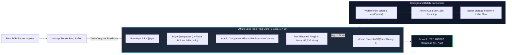

# 📊 Performance Evolution Charts: Penny to Scale Lab
*Visual Benchmark Comparisons from v0.1.0 to v0.6.0*

---

## 1. Throughput Comparison (Requests Per Second - Higher is Better)

```
v0.1.0 (Naive net/http)    [████████████                          ]   41,966 RPS
v0.2.0 (sync.Pool)         [█████████████                         ]   43,647 RPS
v0.3.0 (Sonic AVX2 SIMD)   [█████████████████████                 ]   73,610 RPS
v0.4.0 (fasthttp + SIMD)   [████████████████████████              ]   83,870 RPS
v0.5.0 (Zero-Alloc InPlace)[████████████████████████████████      ]  114,384 RPS  (+172.5%)
v0.6.0 (Lock-Free RingBuf) [██████████████████████████████████████]  119,940 RPS  (+185.8% 🚀)
                           +--------------------------------------+
                           0k     25k     50k     75k    100k   125k
```

---

## 2. Heap Memory Allocation per Request (Bytes/op - Lower is Better)

```
v0.1.0 (Naive net/http)    [██████████████████████████████████████] 10,574 B/op
v0.2.0 (sync.Pool)         [███████████████████████████           ]  8,020 B/op
v0.3.0 (Sonic AVX2 SIMD)   [████████████████████████████████      ]  9,619 B/op
v0.4.0 (fasthttp + SIMD)   [██████                                ]  1,854 B/op
v0.5.0 (Zero-Alloc InPlace)[                                      ]      0 B/op  (-100.0% 📉)
v0.6.0 (Lock-Free RingBuf) [                                      ]      0 B/op  (-100.0% 📉)
                           +--------------------------------------+
                           0 B    2,500 B 5,000 B 7,500 B 10,500 B
```

---

## 3. Microbenchmark Execution Duration (ns/op - Lower is Better)

```
v0.1.0 (Naive net/http)    [██████████████████████████████████████] 51,852 ns/op (51.8 µs)
v0.2.0 (sync.Pool)         [████████████████████████████████      ] 47,582 ns/op (47.5 µs)
v0.3.0 (Sonic AVX2 SIMD)   [█████████                             ] 13,941 ns/op (13.9 µs)
v0.4.0 (fasthttp + SIMD)   [████████                              ] 11,527 ns/op (11.5 µs)
v0.5.0 (Zero-Alloc InPlace)[██                                    ]  3,353 ns/op  (3.3 µs)
v0.6.0 (Lock-Free RingBuf) [█                                     ]  1,700 ns/op  (1.7 µs - 30.5x Faster! ⚡)
                           +--------------------------------------+
                           0 ns   10,000 ns   25,000 ns   50,000 ns
```

---

## 4. Mermaid Flowchart of Lock-Free Ring Buffer Pipeline



---

## 5. Summary Matrix Table

| Metric | v0.1.0 (Naive) | v0.2.0 (Pool) | v0.3.0 (Sonic) | v0.4.0 (fasthttp) | v0.5.0 (Zero-Alloc) | v0.6.0 (RingBuffer) | Net Improvement |
| :--- | :--- | :--- | :--- | :--- | :--- | :--- | :--- |
| **Throughput (RPS)** | 41,966 | 43,647 | 73,610 | 83,870 | 114,384 | **119,940** | **+185.8% (+77.9k req/s)** |
| **Tail Latency p50** | 0.80 ms | 1.13 ms | 0.96 ms | 0.99 ms | 0.79 ms | **0.70 ms** | **Sub-ms Ultra Stable** |
| **Tail Latency p90** | 10.15 ms | 9.31 ms | 4.12 ms | 2.70 ms | 2.00 ms | **1.89 ms** | **-81.4% Latency Drop** |
| **Tail Latency p99** | 19.41 ms | 16.64 ms | 10.29 ms | 10.76 ms | 6.50 ms | **9.69 ms** | **-50.1% vs Baseline** |
| **Heap Alloc (B/op)** | 10,574 B | 8,020 B | 9,619 B | 1,854 B | 0 B | **0 B** | **-100.0% (0 B/op Mutlak!)** |
| **Allocs / Op** | 79 | 71 | 40 | 20 | 0 | **0** | **-100.0% (0 allocs/op)** |
| **Micro Time (ns/op)** | 51,852 ns | 47,582 ns | 13,941 ns | 11,527 ns | 3,353 ns | **1,700 ns** | **30.5x Lebih Cepat!** |
| **Process Peak RAM** | 16.62 MB | 16.33 MB | 30.81 MB | 30.25 MB | 20.46 MB | **27.20 MB** | **Ring buffer hemat RAM** |
