# 📊 Performance Evolution Charts: Penny to Scale Lab
*Visual Benchmark Comparisons from v0.1.0 to v0.5.0*

---

## 1. Throughput Comparison (Requests Per Second - Higher is Better)

```
v0.1.0 (Naive net/http)    [██████████████                        ]   41,966 RPS
v0.2.0 (sync.Pool)         [███████████████                       ]   43,647 RPS
v0.3.0 (Sonic AVX2 SIMD)   [█████████████████████████             ]   73,610 RPS
v0.4.0 (fasthttp + SIMD)   [████████████████████████████          ]   83,870 RPS
v0.5.0 (Zero-Alloc InPlace)[██████████████████████████████████████]  114,384 RPS  (+172.5% 🚀)
                           +--------------------------------------+
                           0k     25k     50k     75k    100k   125k
```

---

## 2. Heap Memory Allocation per Request (Bytes/op - Lower is Better)

```
v0.1.0 (Naive net/http)    [██████████████████████████████████████] 10,574 B/op
v0.2.0 (sync.Pool)         [███████████████████████████           ]  8,020 B/op
v0.3.0 (Sonic AVX2 SIMD)   [████████████████████████████████      ]  9,619 B/op
v0.4.0 (fasthttp + SIMD)   [██████                                ]  1,854 B/op
v0.5.0 (Zero-Alloc InPlace)[▏                                     ]      3 B/op  (-99.97% 📉)
                           +--------------------------------------+
                           0 B    2,500 B 5,000 B 7,500 B 10,500 B
```

---

## 3. Tail Latency p99 (Milliseconds - Lower is Better)

```
v0.1.0 (Naive net/http)    [██████████████████████████████████████] 19.41 ms
v0.2.0 (sync.Pool)         [███████████████████████████████       ] 16.64 ms
v0.3.0 (Sonic AVX2 SIMD)   [██████████████████                    ] 10.29 ms
v0.4.0 (fasthttp + SIMD)   [███████████████████                   ] 10.76 ms
v0.5.0 (Zero-Alloc InPlace)[████████████                          ]  6.50 ms  (-66.5% ⚡)
                           +--------------------------------------+
                           0 ms    5 ms    10 ms   15 ms   20 ms
```

---

## 4. Mermaid Flowchart of Zero-Alloc Request Pipeline

```mermaid
flowchart LR
    A["Raw TCP Packet Ingress"] --> B["fasthttp Socket Ring Buffer"]
    B -->|Zero-Copy ctx.PostBody| C["Raw Byte Slice []byte"]
    
    subgraph ZeroAllocPipeline ["v0.5.0 Zero-Alloc Core (3 B/op)"]
        C --> D["buger/jsonparser (In-Place Pointer Arithmetic)"]
        D -->|event_id slice| E["Tenant & Event Extractor"]
        D -->|tenant_id slice| E
        D -->|timestamp int64| E
        E --> F["sync.Pool Concrete Struct (*zeroAllocResources)"]
        F --> G["hasher.Sum(stackScratch[:0])"]
    end
    
    G --> H["Fast Response Serialization"]
    H --> I["HTTP 200 OK Output Buffer"]
    
    style ZeroAllocPipeline fill:#1e293b,stroke:#38bdf8,stroke-width:2px,color:#fff
    style C fill:#0f172a,stroke:#22c55e,stroke-width:2px,color:#fff
    style G fill:#0f172a,stroke:#eab308,stroke-width:2px,color:#fff
```



---

## 5. Summary Matrix Table

| Metric | v0.1.0 (Naive) | v0.2.0 (Pool) | v0.3.0 (Sonic) | v0.4.0 (fasthttp) | v0.5.0 (Zero-Alloc) | Net Improvement |
| :--- | :--- | :--- | :--- | :--- | :--- | :--- |
| **Throughput (RPS)** | 41,966 | 43,647 | 73,610 | 83,870 | **114,384** | **+172.5%** |
| **Tail Latency p99** | 19.41 ms | 16.64 ms | 10.29 ms | 10.76 ms | **6.50 ms** | **-66.5%** |
| **Tail Latency p90** | 10.15 ms | 9.31 ms | 4.12 ms | 2.70 ms | **2.00 ms** | **-80.3%** |
| **Heap Alloc (B/op)** | 10,574 B | 8,020 B | 9,619 B | 1,854 B | **3 B** | **-99.97%** |
| **Allocs / Op** | 79 | 71 | 40 | 20 | **3** | **-96.2%** |
| **Micro Time (ns/op)** | 51,852 ns | 47,582 ns | 13,941 ns | 11,527 ns | **3,353 ns** | **15.4x Faster** |
