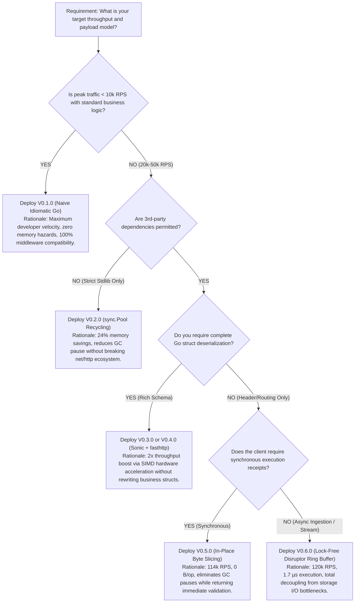

# ⚖️ Architectural Decision Matrix & Production Sweet Spots
## *Matriks Keputusan Arsitektur & Titik Optimal Produksi*

**Penny to Scale Lab — Technical Architecture Guide**  
*Bilingual Edition: English Primary & Bahasa Indonesia*

---

## 🌍 Table of Contents / Daftar Isi
1. [Executive Philosophy / Filosofi Arsitektur](#1-executive-philosophy--filosofi-arsitektur)
2. [Comparative Trade-Off Matrix / Matriks Komparatif Trade-Off](#2-comparative-trade-off-matrix--matriks-komparatif-trade-off)
3. [The Architect's Decision Tree / Pohon Keputusan Arsitek](#3-the-architects-decision-tree--pohon-keputusan-arsitek)
4. [Deep-Dive Analysis Per Release / Bedah Mendalam Tiap Versi](#4-deep-dive-analysis-per-release--bedah-mendalam-tiap-versi)
5. [Staff/Principal Interview Defense / Panduan Wawancara Tingkat Staff](#5-staffprincipal-interview-defense--panduan-wawancara-tingkat-staff)

---

## 1. Executive Philosophy / Filosofi Arsitektur

### 🇬🇧 English
In high-scale systems engineering, optimization is **never** about blindly picking the fastest benchmark number. It is the art of balancing four conflicting forces:
* **Throughput & Tail Latency:** Peak requests per second and p99 stability.
* **Cognitive Complexity & Code Maintainability:** How easily a junior or mid-level engineer can read, debug, and safely modify the code.
* **Ecosystem Compatibility:** Retaining standard Go interfaces (`net/http`, standard contexts, OpenTelemetry, Prometheus, middleware chains).
* **Operational Risk:** The probability of memory leaks, goroutine starvation, unhandled panics, or *use-after-free* buffer bugs.

### 🇮🇩 Bahasa Indonesia
Dalam rekayasa sistem skala besar, optimasi **bukanlah** soal membabi-buta memilih versi dengan angka benchmark tertinggi. Optimasi adalah seni menyeimbangkan empat pilar yang saling tarik-menarik:
* **Throughput & Tail Latency:** Kapasitas request per detik dan stabilitas latensi p99.
* **Kompleksitas Kognitif & Kemudahan Pemeliharaan (*Maintainability*):** Seberapa mudah kode dibaca, di-debug, dan diubah dengan aman oleh developer lain di tim.
* **Kompatibilitas Ekosistem:** Mempertahankan interface standar Go (`net/http`, context standar, tracing OpenTelemetry, metrik Prometheus, middleware).
* **Risiko Operasional:** Probabilitas terjadinya kebocoran memori (*memory leak*), bug buffer reuse (*use-after-free*), atau kepanikan (*panic*) yang tidak tertangani.

---

## 2. Comparative Trade-Off Matrix / Matriks Komparatif Trade-Off

| Version | Architecture & Pattern | Measured Performance | Cognitive Complexity | Operational Risk | 🎯 Production Sweet Spot |
| :--- | :--- | :--- | :--- | :--- | :--- |
| **v0.1.0** | **Naive Baseline** `net/http` + `encoding/json` + `io.ReadAll` | 42k RPS 10.5 KB/op 79 allocs/op p99: 19.4 ms | 🟢 **Very Low** Idiomatic Go, zero external packages. | 🟢 **Zero Risk** Safe garbage collection, standard context. | **CRUD APIs, Internal Microservices, Admin Portals, Early MVPs (<10k RPS)**. When developer velocity and code readability trump cloud hardware cost. |
| **v0.2.0** | **`sync.Pool` Recycling** Buffers, structs & hashers reuse | 43.6k RPS 8.0 KB/op 71 allocs/op p99: 16.6 ms | 🟡 **Low-Medium** Requires strict state reset before release. | 🟡 **Low** Memory leaks if maps/slices are not cleared. | **Services with occasional GC latency spikes**, where the engineering team **strictly requires zero 3rd-party dependencies** and 100% `net/http` compatibility. |
| **v0.3.0** | **ByteDance Sonic** AVX2 SIMD / JIT JSON Engine | 73.6k RPS 9.6 KB/op 40 allocs/op p99: 10.3 ms | 🟢 **Very Low** 1-line drop-in replacement for `json.Unmarshal`. | 🟡 **Medium** Locked to x86_64 CPUs with AVX2 instruction sets. | **High-volume services processing massive or deeply nested JSON payloads**, where CPU profiling shows `reflect` and `mallocgc` burning >40% CPU time, but the team **cannot refactor existing structs**. |
| **v0.4.0** | **`valyala/fasthttp` Engine** Zero-copy TCP ring buffers + Sonic | 83.8k RPS 1.8 KB/op 20 allocs/op p99: 10.7 ms | 🔴 **Medium-High** Abandons standard `net/http` interfaces. | 🔴 **Medium-High** *Use-after-free* hazard if body slice escapes to goroutines. | **Public Edge Ingestion, Reverse Proxies, Webhook Receivers** maintaining tens of thousands of concurrent TCP keep-alive connections while still needing full schema deserialization. |
| **v0.5.0** | **In-Place Byte Slicing** `fasthttp` + `buger/jsonparser` | 114k RPS **0 B/op** **0 allocs/op** p99: 6.5 ms | 🔴 **High** Manual pointer arithmetic and byte offset parsing. | 🔴 **High** No compile-time schema safety; upstream schema drift risks bugs. | **Pure Ingestion Pipelines (Telemetry, IoT metrics, APM collectors, Log routing)** where 90% of the payload is *passthrough* data, and the edge only needs 2-3 fields (`tenant_id`, `event_id`) for routing. |
| **v0.6.0** | **Lock-Free Ring Buffer** LMAX Disruptor Pattern + CAS | 120k RPS **0 B/op** **0 allocs/op** 1.7 µs speed | ⚫ **Very High** Lock-free atomics, ring cursors, async workers. | ⚫ **Very High** Asynchronous error handling; backpressure saturation risks. | **HFT Limit Order Books, AdTech Real-Time Bidding (<10ms hard SLA), Clickstream Ingestion**, where HTTP ingestion **must be totally decoupled** from downstream database/storage persistence. |

---

## 3. The Architect's Decision Tree / Pohon Keputusan Arsitek

---

## 4. Deep-Dive Analysis Per Release / Bedah Mendalam Tiap Versi

### 4.1 V0.1.0: When Idiomatic Go is More Than Enough
* **🇬🇧 English:** Standard `net/http` and `encoding/json` should be the default choice for 90% of business applications. The developer productivity gains, full compatibility with OpenTelemetry distributed tracing, JWT middlewares, and static struct validation vastly outweigh saving a few hundred megabytes of RAM on modern cloud instances.
* **🇮🇩 Bahasa Indonesia:** Library standar `net/http` dan `encoding/json` adalah pilihan mutlak untuk 90% aplikasi bisnis umum. Kecepatan developer menyelesaikan fitur, integrasi instan dengan OpenTelemetry tracing, auth middleware, dan validasi skema bertipe statis jauh lebih berharga daripada menghemat beberapa ratus megabyte RAM di server cloud modern.

### 4.2 V0.2.0: The Zero-Dependency Compromise
* **🇬🇧 English:** Ideal for security-conscious enterprise environments (banking, defense, healthcare) with strict supply-chain policies forbidding external packages. Pooling buffers and structs shaves ~24% off memory overhead without adding a single line to `go.mod`.
* **🇮🇩 Bahasa Indonesia:** Pilihan sempurna bagi industri dengan audit kepatuhan ketat (perbankan, pertahanan, kesehatan) yang membatasi dependensi eksternal. Daur ulang buffer dan struct memangkas ~24% alokasi memori tanpa menambah satu baris pun package asing ke `go.mod`.

### 4.3 V0.3.0 & V0.4.0: Hardware Acceleration & High Concurrency
* **🇬🇧 English:** Deploy V0.3.0 when CPU profilers (`pprof`) indicate that JSON reflection consumes >40% of runtime cycles. Deploy V0.4.0 when your server handles >20,000 idle TCP keep-alive connections that would otherwise choke standard library goroutine stacks.
* **🇮🇩 Bahasa Indonesia:** Gunakan V0.3.0 saat profil CPU (`pprof`) membuktikan bahwa refleksi tipe JSON menyedot >40% komputasi. Gunakan V0.4.0 saat server Anda harus mempertahankan puluhan ribu koneksi TCP *keep-alive* bersamaan yang dapat membebani stack goroutine library standar.

### 4.4 V0.5.0: The Zero-Allocation Passthrough Filter
* **🇬🇧 English:** The golden standard for edge proxies, event routers, and webhook ingestors. Instead of inflating an entire JSON tree into memory, inspect only the envelope (`tenant_id`, `event_id`, `timestamp`) and forward the raw payload directly to Kafka, Pulsar, or S3.
* **🇮🇩 Bahasa Indonesia:** Standar emas untuk edge proxy, router webhook, dan kolektor telemetri. Alih-alih membongkar seluruh pohon JSON ke memori, baca hanya field pembungkus (`tenant_id`, `event_id`, `timestamp`) dan teruskan raw byte payload secara utuh ke antrean Kafka, Pulsar, atau penyimpanan S3.

### 4.5 V0.6.0: The Ultra-Low Latency Decoupled Ingestor
* **🇬🇧 English:** Mandatory when client SLAs forbid waiting for downstream disk or network persistence. By utilizing lock-free circular ring buffers with atomic Compare-And-Swap (CAS), incoming packets are committed to memory in ~1.7 microseconds, completely isolating ingress latency from database checkpointing pauses.
* **🇮🇩 Bahasa Indonesia:** Keharusan mutlak saat SLA latensi klien melarang koneksi menunggu proses penulisan ke disk atau database downstream. Dengan ring buffer melingkar lock-free berbasis operasi atomik CAS, paket request dicatat ke RAM dalam tempo ~1,7 mikrodetik, memisahkan latensi ingress secara tuntas dari jeda flush database.

---

## 5. Staff/Principal Interview Defense / Panduan Wawancara Tingkat Staff

### 🇬🇧 English: How to Answer "Why not use V0.6.0 everywhere?"
> *"Architecture is fundamentally the discipline of managing trade-offs. While V0.6.0 delivers 120k RPS and true 0 B/op, it introduces asynchronous failure boundaries, high cognitive load for new team members, and requires custom backpressure saturation handling. In our production infrastructure, we maintain 80% of our business services on idiomatic V0.1/V0.2 to preserve developer velocity and schema safety. We deploy V0.5/V0.6 exclusively on edge ingestion nodes, high-frequency telemetry collectors, and critical ingress pathways where the traffic volume justifies the zero-allocation complexity."*

### 🇮🇩 Bahasa Indonesia: Cara Menjawab "Kenapa tidak pakai V0.6.0 untuk semua service?"
> *"Arsitektur perangkat lunak pada hakikatnya adalah seni mengelola trade-off. Meskipun V0.6.0 menghasilkan 120k RPS dan 0 B/op mutlak, arsitektur ini membawa batas kegagalan asinkron, beban kognitif tinggi bagi anggota tim baru, dan membutuhkan manajemen saturasi backpressure yang rumit. Di sistem produksi, kami mempertahankan 80% business microservices pada V0.1/V0.2 demi kecepatan rilis fitur dan keamanan skema. Kami menerapkan V0.5/V0.6 secara eksklusif pada edge ingestion node, kolektor telemetri frekuensi tinggi, dan jalur ingress kritis di mana volume trafik sebanding dengan kompleksitas nol alokasi."*
